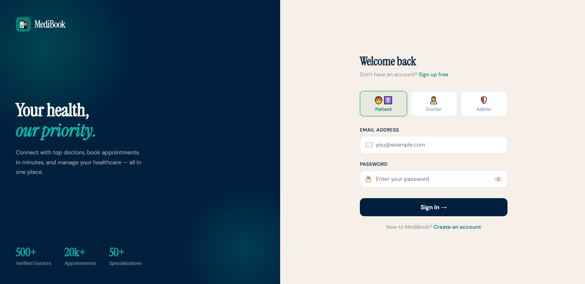
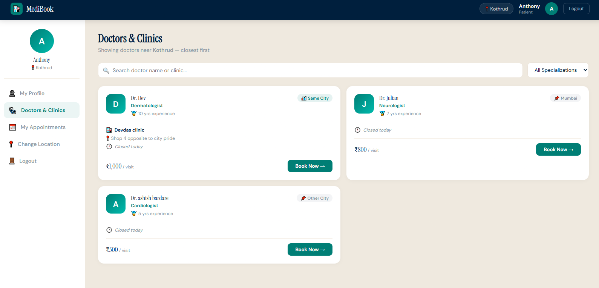
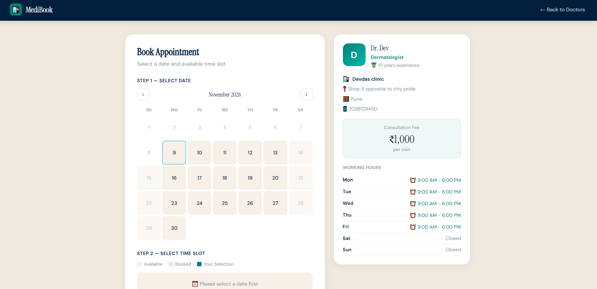
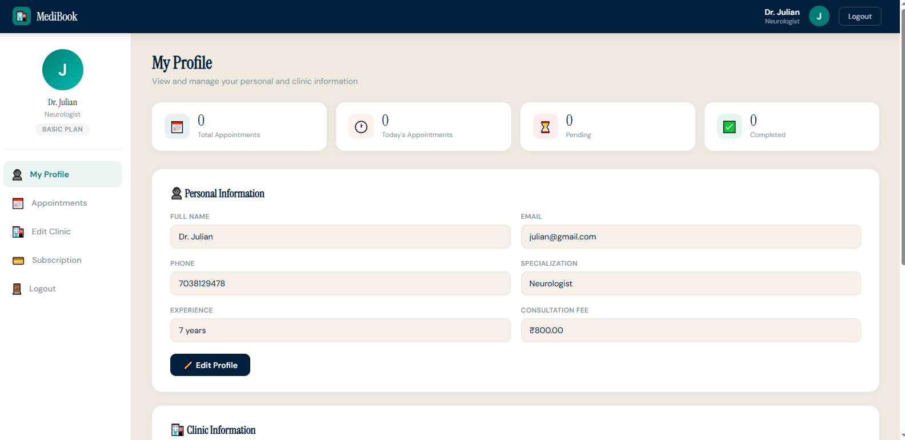

# 🏥 MediBook — Hospital Appointment Booking System

A web application where patients find doctors near them and book appointment slots online, and doctors manage their clinic profile and appointments.

**🔗 Live demo:** https://medibook.free.nf

> The live site runs on free hosting, so the first load can be slow.

---

## ✨ Features

### 👤 Patient
- Register and log in
- Choose your city and area, and doctors are listed closest first (same area, then same city, then others)
- Search doctors by name or clinic, and filter by specialization
- View doctor details: clinic name, address, fees, experience and today's timings
- Book an appointment with a calendar and 30-minute time slots
- See which slots are **available** and which are **booked** (loaded live with AJAX)
- View booked appointments and cancel pending or confirmed ones
- Mobile-friendly layout with a bottom navigation bar

### 🩺 Doctor
- Register as a doctor with specialization, experience and consultation fee
- Set clinic location, clinic name, address and description
- Set weekly office timings with toggles and quick presets
- View patient appointments with patient contact details
- Confirm, complete or cancel appointments
- Dashboard with appointment statistics

### 🔐 General
- Role-based access (patient / doctor), and pages redirect to login if you are not signed in
- Passwords stored as hashes using PHP's `password_hash()`
- Responsive design

---

## 🛠️ Tech Stack

| Layer | Technology |
|---|---|
| Frontend | HTML5, CSS3, JavaScript |
| Backend | PHP (core, no framework) |
| Database | MySQL |
| Other | AJAX (live slot availability) |
| Local server | XAMPP |
| Hosting | InfinityFree |

---

## 📸 Screenshots

_Add 4 to 6 screenshots here (login, patient dashboard, doctor list, slot booking, doctor dashboard)._

| Login | Doctor listing |
|---|---|
|  |  |

| Slot booking | Doctor dashboard |
|---|---|
|  |  |

---

## 📁 Project Structure

```
hospital-booking/
├── index.php                  # Redirects to login
├── auth/
│   ├── login.php
│   ├── register.php
│   └── logout.php
├── includes/
│   └── db.php                 # Database connection + helper functions
├── patient/
│   ├── select-location.php
│   ├── dashboard.php          # Profile, doctors list, my appointments
│   └── book-appointment.php   # Calendar + time slots
├── doctor/
│   ├── select-location.php
│   ├── clinic-details.php
│   └── dashboard.php          # Profile + appointments
└── sql/
    └── hospital.sql           # Database structure
```

---

## 🚀 Run It Locally

### 1. Install XAMPP
Download it from [apachefriends.org](https://www.apachefriends.org), then start **Apache** and **MySQL** in the XAMPP Control Panel.

### 2. Get the project
```bash
git clone https://github.com/omkarsawant-builds/medibook-hospital-booking.git
```
Copy the folder into `C:\xampp\htdocs\` and rename it `hospital-booking`.

### 3. Create the database
1. Open `http://localhost/phpmyadmin`
2. Click **New** and create a database named `hospital_booking`
3. Select it, click **Import**, and choose `sql/hospital.sql`

### 4. Check the database connection
Open `includes/db.php` and make sure it matches your setup:
```php
$conn = mysqli_connect('127.0.0.1', 'root', '', 'hospital_booking', 3306);
```
If your MySQL runs on another port (shown in the XAMPP panel, for example 3307), change the last number.

### 5. Open the app
```
http://localhost/hospital-booking/auth/login.php
```

---

## 🧪 Demo Accounts (live site)

| Role | Email | Password |
|---|---|---|
| Patient | anthony@gmail.com| anthony@123|
| Doctor | julian@gmail.com | julian@123 |

Or create your own on the **Register** page.

---

## 🗄️ Database

Main tables: `users`, `doctors`, `patients`, `appointments`, `time_slots`, `subscription_plans`, `doctor_subscriptions`.

- `users` holds login details and the role (patient, doctor or admin)
- `doctors` holds profile and clinic details, and timings are stored as JSON
- `appointments` links a patient to a doctor with a date, time slot and status (pending, confirmed, completed, cancelled)

---

## 🗺️ Future Improvements

- Admin dashboard to manage users, doctors and appointments
- Doctor subscription plans (tables are already in the database)
- Edit profile pages for patients and doctors
- Email or SMS appointment confirmations
- Switch to prepared statements (PDO or MySQLi) for stronger SQL injection protection
- Doctor ratings and reviews

---

## 👨‍💻 Author

**Omkar Sawant**
BCA student
GitHub: [@omkarsawant-builds](https://github.com/omkarswant-builds)

---

_Built as a BCA second-year project._
